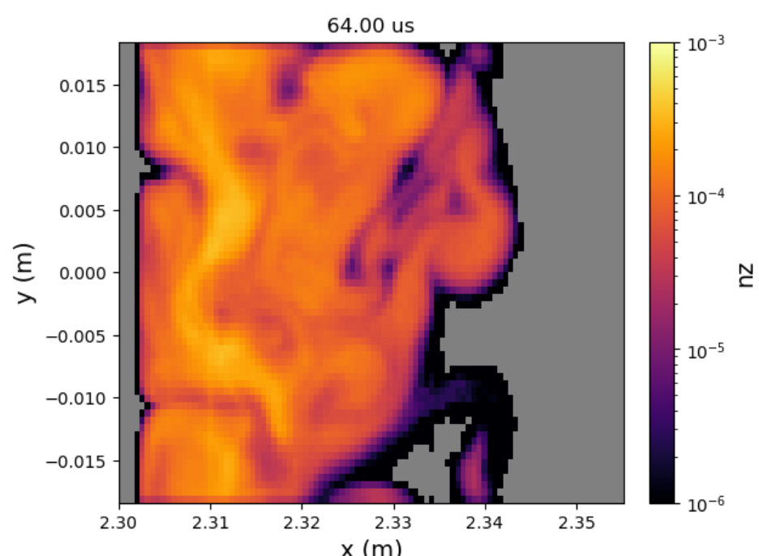

# Flan: Turbulent Trace Impurity Transport

Flan follows trace amounts of impurities through turbulent plasmas. It's a
Monte Carlo code that tracks each impurity ion's full gyro-orbit through a
time-dependent background plasma, usually a turbulence simulation from
[Gkeyll](https://gkeyll.readthedocs.io), and records where the impurities go.
The result is the impurity density, flow and charge state throughout the
plasma, as they evolve in time with the turbulence.

<figure>
  
  <figcaption>Tungsten density from a Flan simulation of the DIII-D far-SOL during shot #167196, 64 µs into the run.</figcaption>
</figure>

## What Flan does

Impurities, i.e., atoms other than the main plasma species, enter a fusion
plasma from the walls and other plasma-facing components. Even in small
amounts they can radiate away power and dilute the fuel, so where they go is
important. In the scrape-off layer (SOL), the transport is dominated by
turbulence, which existing impurity transport codes typically model with
simple diffusion and pinch coefficients.

Flan instead follows the impurities through the turbulence itself. For a heavy
impurity like tungsten, the gyroradius is comparable to the size of the
turbulent fluctuations, so the usual guiding-center approximation breaks down.
Flan makes no such approximation: every particle is pushed through the
electric and magnetic fields with its full gyromotion resolved.

Flan is a *trace* impurity code. The impurities are assumed to be too few to
change the background plasma, and they don't interact with each other. Each
one is followed independently through the background, which is what lets the
calculation be spread across many CPU cores, nodes and GPUs.

## What it can simulate

- **Impurity transport in turbulent plasmas.** The main use is impurities in
  the SOL of a tokamak, in a time-dependent turbulent background from a
  Gkeyll simulation, e.g., tungsten in the DIII-D far-SOL. Flan works with
  Gkeyll's field-aligned, curvilinear coordinates.
- **Many impurity species.** Any impurity can be followed. With
  ionization/recombination on, OpenADAS data is used for H through Ne, Al,
  Si, Cl, Ar, Fe, Kr, Mo, Xe and W.
- **Where impurities start.** Particles can start at one location and time,
  over a range, or anywhere in the simulation, with a set temperature or the
  local ion temperature, and in any charge state, including as neutrals.
- **Different boundaries.** Each boundary can absorb particles, wrap them
  around (periodic), or send them back in from a random spot along it, as
  for particles entering the core.
- **Textbook test cases.** Built-in test backgrounds check that Flan
  reproduces gyration, the ExB, grad-B, polarization and curvature drifts,
  and the friction force from the collision model.

The output is a netCDF file with the impurity density, the average velocity
(in both Cartesian and the simulation's coordinates), the average charge state
and more, on the background's grid at every time frame.

## Physics

- **Full-orbit particle push** with the energy-conserving Boris algorithm.
  The fields are interpolated in space and time to each particle's position.
  See [Impurity Transport](physics/impurity-transport.md).
- **Coulomb collisions** with the background ions and electrons, using the
  Nanbu model, which is valid for any collisionality. See
  [Collisions](physics/collisions.md).
- **Ionization and recombination** from OpenADAS rate coefficients. See
  [Ionization/Recombination](physics/ionization-recombination.md).

## Performance

Flan is written in C++ and built for large simulations, up to hundreds of
millions of particles:

- **OpenMP** threads on each node, see [OpenMP Layout](developer/openmp-layout.md).
- **MPI** across nodes, see [MPI Parallelism](developer/mpi-parallelism.md).
- **NVIDIA GPUs** with CUDA, with the same physics as the CPU version. One
  build runs on either, chosen when the simulation starts.

## Getting started

1. [Install Flan](installation/installation.md) on your machine, as a CPU or
   GPU build.
2. [Set up and run a case](running/running-flan.md). The ExB drift test
   there is a good first run.
3. Choose your [input options](input-options.md).

## Site layout

| Section | What's there |
|---|---|
| [Installation](installation/installation.md) | Building Flan and its dependencies, on [Linux](installation/install-linux.md) and [Perlmutter](installation/install-perlmutter.md). |
| [Running Flan](running/running-flan.md) | Setting up a case, the input file, running it and reading the output, plus job scripts for [Perlmutter](running/running-perlmutter.md) and [Omega](running/running-omega.md). |
| [Input Options](input-options.md) | Every input option, with its type, default and description. |
| Physics | How Flan models [impurity transport](physics/impurity-transport.md), [collisions](physics/collisions.md) and [ionization/recombination](physics/ionization-recombination.md). |
| Developer | How the code is organized ([Code Structure](developer/code-structure.md)), parallelized ([MPI](developer/mpi-parallelism.md), [OpenMP](developer/openmp-layout.md)) and documented ([API Reference](api/namespaces.md)), and how to contribute. |
| [Publications/Presentations](publications.md) | Papers and talks that use Flan. |

## Citing Flan

If you use Flan in your work, please cite:

> S. A. Zamperini, T. N. Bernard, S. Andersen, A. C. D. Hoffmann,
> D. L. Rudakov, and T. Abrams, "Fully generalized, turbulent trace impurity
> transport with Gkeyll and Flan in the DIII-D far-SOL," *Plasma Physics and
> Controlled Fusion* **68**, 075013 (2026).
> [doi:10.1088/1361-6587/ae836b](https://doi.org/10.1088/1361-6587/ae836b)

```bibtex
@article{Zamperini2026,
  author  = {Zamperini, S. A. and Bernard, T. N. and Andersen, S. and
             Hoffmann, A. C. D. and Rudakov, D. L. and Abrams, T.},
  title   = {Fully generalized, turbulent trace impurity transport with
             {Gkeyll} and {Flan} in the {DIII-D} far-{SOL}},
  journal = {Plasma Physics and Controlled Fusion},
  volume  = {68},
  pages   = {075013},
  year    = {2026},
  doi     = {10.1088/1361-6587/ae836b}
}
```

## Contact

Flan is developed by Shawn Zamperini at General Atomics. For questions,
problems or collaborations, contact Shawn at
[zamperinis@fusion.gat.com](mailto:zamperinis@fusion.gat.com). The source
code is on [GitHub](https://github.com/shawnzamperini/flan).

## License

Flan is free for noncommercial use, such as research at universities, national
laboratories and other public research institutions, under the
[PolyForm Noncommercial License 1.0.0](https://polyformproject.org/licenses/noncommercial/1.0.0/)
(see the `LICENSE` file). Commercial use requires a separate license. To
request one, contact Shawn Zamperini
([zamperinis@fusion.gat.com](mailto:zamperinis@fusion.gat.com)).

## About the name

Flan is named after Shawn's dog, Flannery. It doesn't stand for anything.

<figure>
  
  <figcaption>Flannery.</figcaption>
</figure>
