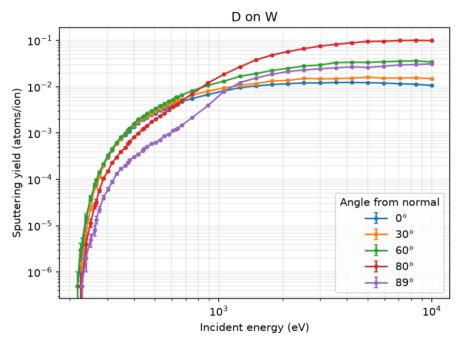
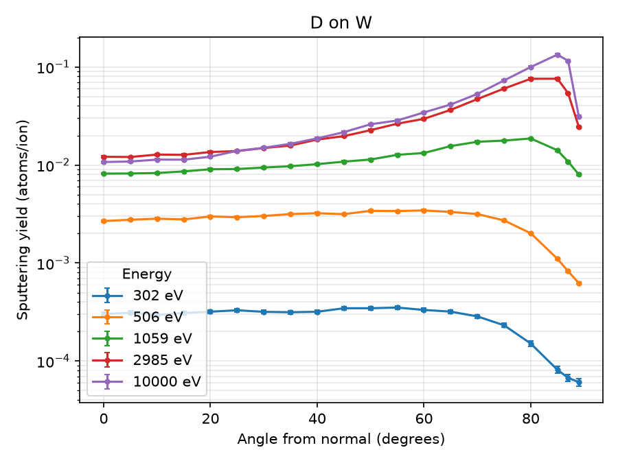

# Sputtering

Ions from the background plasma that hit a wall knock atoms out of it. This
is physical sputtering, and it's the main source of impurities such as
tungsten from divertor targets. How many atoms come out per incident ion is
the sputtering yield $Y$, which depends on the projectile, the wall
material, and the ion's energy and angle of incidence.

!!! note "Work in progress"
    With `imp_source_opt = "sputter"`, Flan follows the atoms the
    background plasma sputters off the wall of a SOLEDGE3X background, as
    this page describes. Sputtering by the impurities themselves, and the
    sheath's effect on where they redeposit, are planned next.

## Where the yields come from

The yields are computed with [RustBCA](https://github.com/lcpp-org/RustBCA)
(Drobny and Curreli, 2021), a binary collision approximation (BCA) code.
A BCA code follows the incident ion and the target atoms it sets moving
through a series of two-body collisions, and counts the target atoms that
leave the surface with enough energy to escape.

RustBCA is installed into the `flan` conda environment when the
environment is set up (see [Installation](../installation/installation.md#rustbca)),
pinned to version 3.0.0 (commit `51bee88`). The tables are made ahead of
time with `python/rustbca_yields.py`, which calls RustBCA's
`sputtering_yield` function, and are kept in the repository in
`data/sputtering/`. Running Flan doesn't need RustBCA, only making a new
table does.

`sputtering_yield` simulates a single-element, semi-infinite target with a
flat surface. It uses RustBCA's default models, which can't be changed
through that function:

| Setting | Model |
|---|---|
| Interatomic potential | Kr-C |
| Electronic stopping | Lindhard-Scharff, nonlocal (`LOW_ENERGY_NONLOCAL`) |
| Mean free path | Liquid (amorphous target) |
| Scattering integral | Mendenhall-Weller quadrature |
| Surface binding | Average (`AVERAGE`), with the target's surface binding energy $E_s$ |
| Bulk binding | Individual, with bulk binding energy $E_b$ |

These are written into each table file along with the RustBCA version, so
it's always known how a table was made.

### Angle convention

The angle of incidence is measured from the surface normal, in degrees: 0
is head-on and 90 is grazing.

### Statistics

The yield at each energy and angle is the number of sputtered atoms
divided by the number of ions run, $N$. Its error is the counting error,
$\sqrt{Y N}/N$. Near threshold, $Y$ can be $10^{-4}$ or smaller, so a fixed
$N$ is either too noisy there or very slow everywhere else. Instead, each
point is run twice:

1. A pilot run with $N_\text{min}$ ions ($10^4$ by default) estimates $Y$.
2. A run with enough ions to count about 2000 sputtered atoms (about 2%
   error), $N = 2000 / Y$, but no fewer than $N_\text{min}$ and no more than
   $N_\text{max}$ ($2\times10^6$ by default). If the pilot run sputtered
   nothing, $N_\text{max}$ ions are used.

RustBCA runs every ion with the same seed, and ion $i$ always uses random
stream $i$, so running more ions repeats the first ones rather than adding
to them. This is why the second run replaces the pilot run rather than
adding to it. The seed is set with `--seed` (default 0), so a table can be
remade exactly.

The energies are run from highest to lowest. Once an angle sputters nothing
with $N_\text{max}$ ions, that energy is below threshold at that angle, and
so are the lower energies. They're set to $Y = 0$ without running them
(their `num_samples` is 0). This saves running millions of ions just to get
zero.

### Energies near threshold

Just above threshold the yield rises very steeply. For D on W it goes up
about fivefold between neighboring energies of a 41-point grid from 10 eV
to 10 keV (19% apart), and interpolating that grid was off from RustBCA by
17% at 280 eV and by a factor of 3.5 at 230 eV. Interpolating $\log Y$
instead didn't help. This is the range that matters most for D on W, since
D ions hit a divertor target with roughly $3T_e + 2T_i$, a few hundred eV
at typical temperatures.

So after the main grid is run, energies about 5% apart are added across
the threshold region: from the highest energy where every angle sputtered
nothing up to 3 times the lowest energy where any angle sputtered
something (`--fine-step` and `--fine-factor`, or `--no-refine` to turn
this off). For D on W this adds 25 energies between 197 and 672 eV.

### Remaking or extending a table

Every point is independent, and RustBCA is seeded the same way for each,
so a point comes out the same in any table made with the same materials,
seed, `--target-counts`, `--n-min` and `--n-max`. `--reuse FILE` copies the
points of an existing table instead of running them again, e.g., to add
energies or angles to a table without remaking the rest. The script checks
that the existing table was made with the same settings, which are saved
as attributes of each table, and stops if not.

## Table files

Each projectile and target pair has its own HDF5 file,
`data/sputtering/{projectile}_on_{target}.h5`, e.g., `D_on_W.h5` for
deuterium on tungsten.

| Dataset | Shape | Units | Contents |
|---|---|---|---|
| `/energy` | (nE) | eV | Incident energies, log spaced |
| `/angle` | (nA) | degrees | Incident angles from the surface normal |
| `/yield` | (nE, nA) | atoms/ion | Sputtering yield |
| `/yield_err` | (nE, nA) | atoms/ion | Counting error of the yield |
| `/num_samples` | (nE, nA) | | Number of ions run for each point |
| `/projectile/Z`, `/projectile/mass_amu` | scalar | , amu | Projectile atomic number and mass |
| `/projectile/Es`, `/projectile/Ec` | scalar | eV | Projectile surface binding and cutoff energies |
| `/target/Z`, `/target/mass_amu` | scalar | , amu | Target atomic number and mass |
| `/target/n` | scalar | m$^{-3}$ | Target number density |
| `/target/Es`, `/target/Eb`, `/target/Ec` | scalar | eV | Target surface binding, bulk binding and cutoff energies |

The root group's attributes record where the table came from: the
projectile and target names, the RustBCA version and commit, the date, the
command that made it, the RustBCA models above, and the sampling settings
(`seed`, `target_counts`, `n_min`, `n_max`, `refine`, `fine_step` and
`fine_factor`). Flan only
reads datasets, so everything it needs is a dataset rather than an
attribute.

A table can be looked at with `h5dump` or h5py, e.g.,

```python
import h5py
with h5py.File("data/sputtering/D_on_W.h5") as f:
    print(dict(f.attrs))
    print(f["energy"][:], f["angle"][:], f["yield"][:])
```

### Tables in the repository

| File | Projectile | Target | Energies | Angles |
|---|---|---|---|---|
| `D_on_W.h5` | D | W | 66: 41 from 10 eV to 10 keV, plus 25 from 197 to 672 eV | 20, 0 to 85° every 5°, 87° and 89° |

The D on W yields, as a function of energy at a few angles and as a
function of angle at a few energies (made with `--plot-only` and
`--save-plots`). The threshold is about 200 eV at every angle. Above a few
keV the yield rises toward grazing incidence, peaking around 85°, and
near threshold it's highest at moderate angles.





Interpolating this table agrees with RustBCA run at energies and angles
between the table's points to within the statistical error: within about
5% above 280 eV, and within the (large) counting error of RustBCA itself
just above threshold, where the yield is below $10^{-5}$.

## How Flan uses a table

A table is read by `Sputtering::YieldTable` (`src/sputtering.cpp`), which
checks it as it's read: the run stops with a message if a dataset is
missing, the yield has the wrong shape, there are fewer than two energies
or angles, the energies aren't positive and increasing, the angles aren't
increasing within 0 to 90°, or a yield is negative.

The yield at energy $E$ and angle $\theta$ is bilinearly interpolated,
linear in $\log_{10} E$ and in $\theta$. $Y$ itself is interpolated rather
than $\log Y$, because $Y = 0$ below threshold. Outside the table:

- Below the lowest energy, $Y = 0$. Tables start below threshold, so this
  is the right answer, not an extrapolation.
- Above the highest energy, the yield at the highest energy is used.
- Angles are clamped to the table's range, so 90° uses the largest angle
  in the table (89° for the default angles).

## Wall surfaces

The surfaces the plasma sputters are found by `Sputtering::Surface`
(`src/sputtering.cpp`), for SOLEDGE3X backgrounds.

SOLEDGE3X doesn't fit its mesh to the wall. The mesh runs past the wall,
and a mask, chi, marks the cells inside the wall (chi = 1) and in the
plasma (chi = 0). So the divertor targets at the ends of the mesh
(SOLEDGE3X's -1 faces, Flan's wall faces) are inside the material, and the
surface the plasma actually touches is wherever a plasma cell sits next to
a wall cell. In the poloidal plane, that's a staircase of cell faces. The
mesh file also has the real wall as an outline (`/walls`), which runs
smoothly through the staircase.

Neither is good enough alone. The staircase faces are where a sputtered
atom can start (an atom in a chi = 1 cell is absorbed) and say which
cell's plasma to use, but they point along the grid rather than
perpendicular to the wall, and there's more of them than there is wall:
a staircase is up to $\sqrt{2}$ times longer than the slope it follows.
The outline has the right direction and length, but cuts through cells.

So each staircase face becomes a surface element that keeps the face's
position and plasma cell, but takes its direction from the outline:

- **Normal.** The element's normal $\hat{n}_\text{wall}$ is that of the
  outline segment nearest to the middle of the face, pointed into the
  plasma. It's the normal for the ion flux onto the wall and for the
  direction sputtered atoms leave in.
- **Area.** The face's own area is projected onto the wall,
  $A = A_\text{face}\,|\hat{n}_\text{face}\cdot\hat{n}_\text{wall}|$. A
  stretch of wall of length $L$ at angle $a$ to the grid is covered by
  steps of total length $L|\cos a|$ and $L|\sin a|$ in the two grid
  directions, whose projections add up to $L\cos^2 a + L\sin^2 a = L$, so
  the elements' areas add up to the wall's, not the staircase's.

Where the nearest outline segment is more than 2 cell widths from a face,
the outline doesn't describe that part of the wall (chi marks something it
doesn't include), and the element falls back to the face's own normal and
area. The same happens everywhere if the mesh file has no outline. How
many elements fall back depends on how closely a mesh's chi follows its
outline.

## Sputtered source

With `imp_source_opt = "sputter"`, Flan finds the wall surfaces and
calculates the rate atoms are sputtered off each surface element in each
background time frame (`Sputtering::Source`),

$$
S = \Gamma\, Y_\text{eff}\, A,
$$

using the plasma in the element's plasma cell. The yield table is set with
`sput_table_file`, and its target must be the impurity being followed
(`imp_atom_num`).

### Ion flux onto the wall

Ions move along the field with the parallel flow $u_\parallel$ and across it
with the $\mathbf{E}\times\mathbf{B}$ drift, so their velocity into the wall
is $-(u_\parallel\hat{\mathbf{b}} + \mathbf{v}_E)\cdot\hat{\mathbf{n}}$, where
$\hat{\mathbf{n}}$ is the element's normal (pointing into the plasma) and
$\mathbf{v}_E = \mathbf{E}\times\mathbf{B}/B^2$. The flux is

$$
\Gamma = n_i \max\left(0,\ -(u_\parallel\hat{\mathbf{b}} + \mathbf{v}_E)\cdot\hat{\mathbf{n}}\right),
$$

with $n_i = n_e$. The parallel flow and the drift are perpendicular,
separate parts of the motion: the parallel flow is the part along
$\hat{\mathbf{b}}$, and $\mathbf{v}_E$ has no part along it. Near a
divertor target, where the field hits the wall at a grazing angle and
$\hat{\mathbf{b}}\cdot\hat{\mathbf{n}}$ is small, the drift can carry as
many ions onto the wall as the parallel flow. In a turbulent background it
also carries the turbulent fluctuations, so the source changes from frame
to frame. The grad-B drift in the background's flow isn't used, since it's
mostly a magnetization flow that doesn't carry ions onto the wall.

`sput_flux_opt = "parallel"` leaves out the $\mathbf{E}\times\mathbf{B}$ part,
and `sput_bohm_floor = "on"` makes the parallel flow onto the wall at least
the sound speed $c_s = \sqrt{e(T_e + T_i)/m_i}$ (the Bohm criterion), for
backgrounds whose flow next to the wall is too slow.

### Impact energy and effective yield

Only the background ions sputter. Electrons are far too light: one can give
a W atom at most $4m_e M/(m_e + M)^2 \approx 10^{-5}$ of its energy, far
below the binding energy. $T_e$ comes in only because the electrons set
the sheath potential the ions are accelerated by. An ion gains energy
falling through the sheath and presheath in front of the wall,

$$
E_\text{sheath} = Z\left[-\tfrac{1}{2}T_e\ln\!\left(2\pi\frac{m_e}{m_i}\left(1 + \frac{T_i}{T_e}\right)\right) + \tfrac{1}{2}T_e\right],
$$

the floating sheath drop plus $\tfrac{1}{2}T_e$ for the presheath, about
$3.3\,T_e$ for deuterium at $T_i = T_e$. On top of that is its thermal
energy. The ions hitting a wall are weighted toward the fast ones (by
their speed into it), so their thermal energy has the distribution
$p(\varepsilon) = (\varepsilon/T_i^2)\,e^{-\varepsilon/T_i}$, with mean
$2T_i$. The mean impact energy is $E_\text{sheath} + 2T_i$.

The yield is averaged over these energies at the fixed angle
`sput_angle_val` (60° by default),

$$
Y_\text{eff} = \int_0^\infty Y(E_\text{sheath} + \varepsilon)\, p(\varepsilon)\, d\varepsilon.
$$

This matters near threshold, where the yield rises steeply, so the yield
at the mean energy can be far from the mean yield. The integral is done
with the midpoint rule on 300 points up to $30\,T_i$, since the yield's
kink at threshold would spoil a Gauss-Laguerre rule.

The sheath formula assumes no secondary electron emission from the wall,
which would make the drop smaller.

### Output

The source is saved in the netCDF file's `sputtering` group, which has an
`element` dimension and uses the file's `time` dimension:

| Variable | Shape | Units | Contents |
|---|---|---|---|
| `zone`, `i`, `j`, `k` | (element) | | Plasma cell of the element (zones numbered from 1) |
| `face` | (element) | | Face of the plasma cell on the wall (0 to 5: xmin, xmax, ymin, ymax, zmin, zmax) |
| `R0`, `Z0`, `R1`, `Z1`, `R_mid`, `Z_mid` | (element) | m | The face's corners and middle |
| `phi_min`, `phi_max` | (element) | rad | The element's range of toroidal angle |
| `n_R`, `n_Z` | (element) | | Unit normal into the plasma |
| `area`, `area_face` | (element) | m$^2$ | The element's area, and its cell face's |
| `wall_dist` | (element) | m | Distance from the face to the wall outline |
| `fallback` | (element) | | 1 if the face's own normal and area are used |
| `flux` | (time, element) | m$^{-2}$s$^{-1}$ | Ion flux onto the wall |
| `flux_par`, `flux_exb` | (time, element) | m$^{-2}$s$^{-1}$ | Its parallel and E x B parts, positive into the wall |
| `energy` | (time, element) | eV | Mean impact energy |
| `yield` | (time, element) | atoms/ion | Effective yield |
| `rate` | (time, element) | atoms/s | Sputtered atoms |
| `total_rate` | (time) | atoms/s | Sum over the elements |

A summary is also printed at the start of the run: the total rate, the ion
flux onto the wall and how much came from each part, and the flux-weighted
mean impact energy and yield. The `source_rate` attribute of the group is
the total rate averaged over the run (see below).

## Starting the sputtered atoms

With `imp_source_opt = "sputter"`, every particle is a W atom sputtered off
the wall (`Sputtering::Source::sample_birth`), and the `imp_*start_opt`,
`imp_zone_start_val`, `imp_temp_start_opt` and `imp_init_charge` options
aren't used:

1. **Which element and when.** Each time frame stands for the times
   nearer to it than to any other frame, a window of length $\Delta t$, so
   an element sputters $S\,\Delta t$ atoms in it. A frame and element are
   picked with that weight, and the time uniformly in the frame's window.
2. **Where.** Uniformly along the element's face and its range of
   toroidal angle, a thousandth of a cell inside the plasma cell, so the
   atom doesn't start in the wall cell.
3. **Which ion sputtered it.** Near threshold only the fast ions sputter,
   so the energy $E_i$ of the ion is picked from the ions that sputter,
   whose energies go as $Y(E)\,p(\varepsilon)$, the same integrand as
   $Y_\text{eff}$.
4. **How fast.** The atom's energy is from the Thompson distribution,
   $f(E) \propto E/(E + E_b)^3$, with the target's surface binding energy
   $E_b$ from the yield table (8.79 eV for W). The distribution is cut off
   at the most energy the ion can give a target atom in one collision,
   $\Lambda E_i$ with $\Lambda = 4m_1m_2/(m_1 + m_2)^2$ (0.043 for D on W),
   and sampled exactly by inverting its cumulative distribution. So near
   threshold, where most D on W sputtering is, the atoms are slow: a
   300 eV ion can give a W atom at most 13 eV.
5. **Which way.** A cosine distribution about the element's normal.

The atoms start neutral. Each one's weight, the number of real atoms/s it
stands for, is $\bar{S}/N$, where $\bar{S}$ is the total rate averaged over
the frames' windows and $N$ = `imp_num`, so the densities come out in
m$^{-3}$. (A "manual" run does the same with `imp_source_scale_fact` in
place of $\bar{S}$.) The atoms are picked in proportion to where they're
sputtered, so they all have the same weight. If nothing is sputtered, the
run stops.

## Redeposition

With `imp_source_opt = "sputter"`, Flan also tallies where the sputtered
atoms land back on the wall (`Sputtering::Deposition`). An atom that moves
into a wall cell (chi = 1) is absorbed and put on the surface element
between that wall cell and the plasma cell it came from. Since every
atom's weight is the atoms/s it stands for, adding up the weights landing
on an element gives the rate atoms are redeposited there, and subtracting
that from the element's source (averaged over the run) gives its net
erosion. How long after being sputtered each atom landed, and its charge
then, are tallied too.

A summary is printed at the end of the run: the redeposited rate and its
share of the source, the share back within 1 µs, 10 µs, 100 µs and 1 ms,
and the mean charge when they land. The tallies are saved in the
`sputtering` group:

| Variable | Shape | Units | Contents |
|---|---|---|---|
| `source_mean` | (element) | atoms/s | Sputtered rate averaged over the frames' windows |
| `redeposited` | (element) | atoms/s | Rate atoms land back on the element |
| `net_erosion` | (element) | atoms/s | `source_mean - redeposited`, negative where more land than leave |
| `lifetime_edges` | (lifetime_edge) | s | Edges of the time since birth bins, 10 per decade from 10$^{-10}$ to 10$^{-1}$ s |
| `redeposited_lifetime` | (lifetime_bin) | atoms/s | Redeposited rate by time since birth |
| `redeposited_charge` | (charge) | atoms/s | Redeposited rate by charge when they landed (0 to Z) |

and the attributes `redeposited_total`, `redeposited_wall_face` (atoms
absorbed at the end of a zone, not on an element) and
`redeposited_unassigned` (atoms that went more than a cell into the wall
in one step, so their element isn't known).

There's no sheath in the background, so atoms close to the wall don't feel
its strong electric field. Prompt redeposition, of atoms that come back
within their first gyration after ionizing, is underestimated until the
sheath is resolved.

## Making a new table

Activate the `flan` environment, which has RustBCA, and run the script
with the projectile and target:

```bash
conda activate flan
python python/rustbca_yields.py D W
```

This writes `data/sputtering/D_on_W.h5`. It prints each energy as it
finishes. The `D_on_W.h5` table took about 3 hours on 20 cores (RustBCA
runs the ions in parallel on every core): 70 minutes for the main grid and
100 minutes for the energies near threshold, where most points need the
full $N_\text{max}$ ions. Before a full run, try
`--quick`, which uses a coarse grid and few ions and takes seconds:

```bash
python python/rustbca_yields.py D W --quick --out test.h5 --plot
```

The options are:

| Option | Default | Description |
|---|---|---|
| `projectile`, `target` | `D`, `W` | Names from the script's `MATERIALS` table. A target needs a density and bulk binding energy. |
| `--out` | `data/sputtering/{projectile}_on_{target}.h5` | Output file |
| `--emin`, `--emax` | 10, 10000 | Energy range (eV) |
| `--ne` | 41 | Number of log-spaced energies |
| `--angles` | 0 to 85 every 5, 87, 89 | Angles from the normal (degrees), between 0 and 90 |
| `--target-counts` | 2000 | Sputtered atoms to aim for at each point |
| `--n-min` | 10000 | Ions in each pilot run, and the fewest per point |
| `--n-max` | 2000000 | Most ions per point |
| `--seed` | 0 | RustBCA seed |
| `--no-refine` | | Don't add energies near threshold |
| `--fine-step` | 0.05 | Fractional spacing of the energies added near threshold |
| `--fine-factor` | 3 | Energies are added up to this times the lowest energy that sputters anything |
| `--reuse FILE` | | Copy points from an existing table made with the same settings instead of running them |
| `--target-Es` | | Override the target's surface binding energy (eV) |
| `--quick` | | Coarse grid (9 energies, 4 angles) and few ions, for testing |
| `--plot` | | Plot the table after making it |
| `--plot-only FILE` | | Only plot an existing table |
| `--save-plots PREFIX` | | Save the plots as `PREFIX_energy.png` and `PREFIX_angle.png` instead of showing them |

### Adding a projectile or target

The materials are defined in the `MATERIALS` dictionary at the top of
`python/rustbca_yields.py`. Add an entry with:

| Key | Units | Needed for | Description |
|---|---|---|---|
| `Z` | | both | Atomic number |
| `m` | amu | both | Mass |
| `Es` | eV | both | Surface binding energy. For a target, usually the heat of sublimation. |
| `Ec` | eV | both | Cutoff energy, below which RustBCA stops following a particle |
| `Eb` | eV | target | Bulk binding energy (often 0 for metals) |
| `n` | m$^{-3}$ | target | Number density |

RustBCA's `scripts/materials.py` (in `$FLANSOFT/RustBCA`) has values for
many elements, but calls them example values, so check them. The values in
use now are:

| Material | Z | m (amu) | $E_s$ (eV) | $E_c$ (eV) | $E_b$ (eV) | n (m$^{-3}$) |
|---|---|---|---|---|---|---|
| D | 1 | 2.014 | 1.5 | 0.1 | | |
| W | 74 | 183.84 | 8.79 | 3.0 | 0 | $6.306\times10^{28}$ |

$E_s$ for W is its heat of sublimation, the same binding energy that will
be used for the energy distribution of sputtered atoms (Thompson, 1968). RustBCA's `materials.py` uses
8.9 eV. Near threshold the yield is sensitive to $E_s$.

Then make the table, look at the plots, check it against reference data
(see [Validation](#validation)), add it to the
[table of files above](#tables-in-the-repository), and commit it with the
command that made it in the commit message.

## Validation

!!! note "To do"
    Compare the D on W yields with Eckstein's tabulated values (Eckstein,
    2007; Eckstein, 2002) and the Bohdansky-Eckstein fit, at normal
    incidence and as a function of angle, and add the plots here. Expected
    features: a threshold of roughly 200 eV at normal incidence, and at
    high energy a yield that rises toward grazing incidence before falling
    near 90°.

<!--
Plots to add, made with `python python/rustbca_yields.py --plot-only
data/sputtering/D_on_W.h5 --save-plots ...` plus the reference data:


-->

## Limitations

- **Pure, fresh targets.** Each table is for a single-element target with
  nothing implanted in it. A real wall holds deuterium and other
  impurities near its surface, and can be rough, both of which change the
  yield.
- **Physical sputtering only.** Chemical sputtering, sputtering of loosely
  bound surface atoms (ad-atoms) and evaporation aren't included.
- **Threshold region.** Near threshold, the yield depends strongly on the
  surface binding model and $E_s$, and BCA codes are least accurate there.
  For D on W this is the energy range that matters most at typical
  divertor temperatures, so the uncertainty in the yield is largest where
  it counts.
- **No sputtering by the impurities themselves** (self-sputtering) or by
  other impurities in the plasma yet.
- **Fixed angle of incidence.** Every ion hits at `sput_angle_val`. In
  reality the angle depends on the field angle and the sheath.
- **Atoms start on the staircase.** An atom starts at a staircase face,
  but its direction is about the outline's normal, which can be tilted
  from the face's. A direction that points back through the face goes
  into the wall cell, and the atom is absorbed on its first step (with
  `s3x_chi_absorb = "on"`). For a cosine distribution, that's 0.8% of
  atoms where the two normals are 10° apart, 7% at 30° and 15% at 45°.
  Starting positions are also off the real wall by up to about a cell.
- **Sputtered atoms' distributions.** The Thompson energy and cosine
  angle distributions are the usual approximations. RustBCA could give the
  real distributions for each impact energy and angle instead.

## References

- J. Drobny and D. Curreli, "RustBCA: A high-performance
  binary-collision-approximation code for ion-material interactions",
  *J. Open Source Softw.* **6**, 3298 (2021).
- W. Eckstein, "Sputtering yields", in *Sputtering by Particle Bombardment*,
  Topics Appl. Phys. **110**, 33 (2007).
- W. Eckstein, "Calculated sputtering, reflection and range values",
  IPP Report 9/132 (2002).
- M. W. Thompson, "The energy spectrum of ejected atoms during the high
  energy sputtering of gold", *Philos. Mag.* **18**, 377 (1968).
