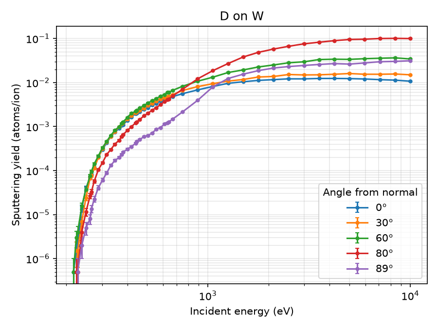
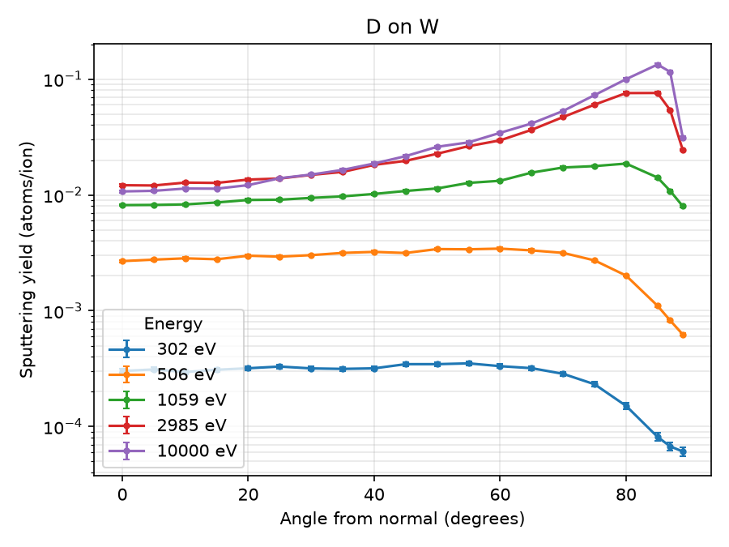

# Sputtering

Ions from the background plasma that hit a wall knock atoms out of it. This
is physical sputtering, and it's the main source of impurities such as
tungsten from divertor targets. How many atoms come out per incident ion is
the sputtering yield $Y$, which depends on the projectile, the wall
material, and the ion's energy and angle of incidence.

With `imp_source_opt = "sputter"`, Flan follows the atoms the background
plasma sputters off the wall of a SOLEDGE3X background, off the targets of
a HERMES background, or off a wall face of the slab background. The
sheath's electric field pulls the ions they become back to the wall
([The sheath](#the-sheath)), and with `sput_self = "on"` the impurities
landing on the wall sputter more of it
([Self-sputtering](#self-sputtering)). All of this is CPU only. How it
was built and checked is in the
[Sheath and Self-Sputtering Plan](../developer/sheath-plan.md).

## Where the yields come from

The yields are computed with [RustBCA](https://github.com/lcpp-org/RustBCA)
(Drobny and Curreli, 2021), a binary collision approximation (BCA) code.
A BCA code follows the incident ion and the target atoms it sets moving
through a series of two-body collisions, and counts the target atoms that
leave the surface with enough energy to escape.

RustBCA is installed into the `flan` conda environment when the
environment is set up (see [Installation](../installation/installation.md#rustbca)),
pinned to version 3.0.0 (commit `51bee88`). The tables are made ahead of
time with `python/rustbca_yields.py`, which calls RustBCA's
`sputtering_yield` function, and are kept in the repository in
`data/sputtering/`. Running Flan doesn't need RustBCA, only making a new
table does.

`sputtering_yield` simulates a single-element, semi-infinite target with a
flat surface. It uses RustBCA's default models, which can't be changed
through that function:

| Setting | Model |
|---|---|
| Interatomic potential | Kr-C |
| Electronic stopping | Lindhard-Scharff, nonlocal (`LOW_ENERGY_NONLOCAL`) |
| Mean free path | Liquid (amorphous target) |
| Scattering integral | Mendenhall-Weller quadrature |
| Surface binding | Average (`AVERAGE`), with the target's surface binding energy $E_s$ |
| Bulk binding | Individual, with bulk binding energy $E_b$ |

These are written into each table file along with the RustBCA version, so
it's always known how a table was made.

### Angle convention

The angle of incidence is measured from the surface normal, in degrees: 0
is head-on and 90 is grazing.

### Statistics

The yield at each energy and angle is the number of sputtered atoms
divided by the number of ions run, $N$. Its error is the counting error,
$\sqrt{Y N}/N$. Near threshold, $Y$ can be $10^{-4}$ or smaller, so a fixed
$N$ is either too noisy there or very slow everywhere else. Instead, each
point is run twice:

1. A pilot run with $N_\text{min}$ ions ($10^4$ by default) estimates $Y$.
2. A run with enough ions to count about 2000 sputtered atoms (about 2%
   error), $N = 2000 / Y$, but no fewer than $N_\text{min}$ and no more than
   $N_\text{max}$ ($2\times10^6$ by default). If the pilot run sputtered
   nothing, $N_\text{max}$ ions are used.

RustBCA runs every ion with the same seed, and ion $i$ always uses random
stream $i$, so running more ions repeats the first ones rather than adding
to them. This is why the second run replaces the pilot run rather than
adding to it. The seed is set with `--seed` (default 0), so a table can be
remade exactly.

The energies are run from highest to lowest. Once an angle sputters nothing
with $N_\text{max}$ ions, that energy is below threshold at that angle, and
so are the lower energies. They're set to $Y = 0$ without running them
(their `num_samples` is 0). This saves running millions of ions just to get
zero.

### Energies near threshold

Just above threshold the yield rises very steeply. For D on W it goes up
about fivefold between neighboring energies of a 41-point grid from 10 eV
to 10 keV (19% apart), and interpolating that grid was off from RustBCA by
17% at 280 eV and by a factor of 3.5 at 230 eV. Interpolating $\log Y$
instead didn't help. This is the range that matters most for D on W, since
D ions hit a divertor target with roughly $3T_e + 2T_i$, a few hundred eV
at typical temperatures.

So after the main grid is run, energies about 5% apart are added across
the threshold region: from the highest energy where every angle sputtered
nothing up to 3 times the lowest energy where any angle sputtered
something (`--fine-step` and `--fine-factor`, or `--no-refine` to turn
this off). For D on W this adds 25 energies between 197 and 672 eV.

### Remaking or extending a table

Every point is independent, and RustBCA is seeded the same way for each,
so a point comes out the same in any table made with the same materials,
seed, `--target-counts`, `--n-min` and `--n-max`. `--reuse FILE` copies the
points of an existing table instead of running them again, e.g., to add
energies or angles to a table without remaking the rest. The script checks
that the existing table was made with the same settings, which are saved
as attributes of each table, and stops if not.

## Table files

Each projectile and target pair has its own HDF5 file,
`data/sputtering/{projectile}_on_{target}.h5`, e.g., `D_on_W.h5` for
deuterium on tungsten.

| Dataset | Shape | Units | Contents |
|---|---|---|---|
| `/energy` | (nE) | eV | Incident energies, log spaced |
| `/angle` | (nA) | degrees | Incident angles from the surface normal |
| `/yield` | (nE, nA) | atoms/ion | Sputtering yield |
| `/yield_err` | (nE, nA) | atoms/ion | Counting error of the yield |
| `/num_samples` | (nE, nA) | | Number of ions run for each point |
| `/projectile/Z`, `/projectile/mass_amu` | scalar | , amu | Projectile atomic number and mass |
| `/projectile/Es`, `/projectile/Ec` | scalar | eV | Projectile surface binding and cutoff energies |
| `/target/Z`, `/target/mass_amu` | scalar | , amu | Target atomic number and mass |
| `/target/n` | scalar | m$^{-3}$ | Target number density |
| `/target/Es`, `/target/Eb`, `/target/Ec` | scalar | eV | Target surface binding, bulk binding and cutoff energies |

The root group's attributes record where the table came from: the
projectile and target names, the RustBCA version and commit, the date, the
command that made it, the RustBCA models above, and the sampling settings
(`seed`, `target_counts`, `n_min`, `n_max`, `refine`, `fine_step` and
`fine_factor`). Flan only
reads datasets, so everything it needs is a dataset rather than an
attribute.

A table can be looked at with `h5dump` or h5py, e.g.,

```python
import h5py
with h5py.File("data/sputtering/D_on_W.h5") as f:
    print(dict(f.attrs))
    print(f["energy"][:], f["angle"][:], f["yield"][:])
```

### Tables in the repository

| File | Projectile | Target | Energies | Angles |
|---|---|---|---|---|
| `D_on_W.h5` | D | W | 66: 41 from 10 eV to 10 keV, plus 25 from 197 to 672 eV | 20, 0 to 85° every 5°, 87° and 89° |
| `W_on_W.h5` | W | W | 66: 41 from 10 eV to 10 keV, plus 25 from 17 to 60 eV | 20, as above |

The D on W yields, as a function of energy at a few angles and as a
function of angle at a few energies (made with `--plot-only` and
`--save-plots`). The threshold is about 200 eV at every angle. Above a few
keV the yield rises toward grazing incidence, peaking around 85°, and
near threshold it's highest at moderate angles.





Interpolating this table agrees with RustBCA run at energies and angles
between the table's points to within the statistical error: within about
5% above 280 eV, and within the (large) counting error of RustBCA itself
just above threshold, where the yield is below $10^{-5}$.

W on W (`W_on_W.h5`, for [self-sputtering](#self-sputtering)) has a much
lower threshold, about 40 eV at normal incidence, since a W projectile
can give all its energy to a W atom ($\Lambda = 1$). The yield passes 1
near 900 eV at normal incidence and a few hundred eV at 60°, and reaches
about 5 at normal incidence and 10 at 60° by 10 keV. Impacts above
10 keV use the 10 keV yield (see below), and are counted in the output.

## How Flan uses a table

A table is read by `Sputtering::YieldTable` (`src/sputtering.cpp`), which
checks it as it's read: the run stops with a message if a dataset is
missing, the yield has the wrong shape, there are fewer than two energies
or angles, the energies aren't positive and increasing, the angles aren't
increasing within 0 to 90°, or a yield is negative.

The yield at energy $E$ and angle $\theta$ is bilinearly interpolated,
linear in $\log_{10} E$ and in $\theta$. $Y$ itself is interpolated rather
than $\log Y$, because $Y = 0$ below threshold. Outside the table:

- Below the lowest energy, $Y = 0$. Tables start below threshold, so this
  is the right answer, not an extrapolation.
- Above the highest energy, the yield at the highest energy is used.
- Angles are clamped to the table's range, so 90° uses the largest angle
  in the table (89° for the default angles).

## Wall surfaces

The surfaces the plasma sputters are found by `Sputtering::Surface`
(`src/sputtering.cpp`). How depends on whether the mesh is fitted to the
wall.

### HERMES: grids fitted to the targets

A hypnotoad grid ends at the divertor targets, so the targets are the
zone faces Flan marks as wall faces (the y ends of the legs and PFRs).
Every cell face on a target is a surface element with its own normal,
pointing into the plasma, and its own area, which are the target's. There
is no wall mask and nothing to correct, so the rest of this section,
about SOLEDGE3X, doesn't apply. The outer edges of the SOL and the PFRs
are absorbing faces, not walls, and aren't sputtered.

### Slab: one wall face

The slab background can have one face of its box as a wall
(`slab_wall`), with the magnetic field at an angle to it
(`slab_b_angle`). It's for checking sputtering and redeposition against
analytic results. The box is Cartesian, so the wall is flat. Its surface
elements are the cell faces on that side of the box, with the box's normal
and the cells' areas, as for a HERMES target. In the output, the elements'
R, Z and phi are the slab's X, Y and Z (`cartesian` = 1).

### SOLEDGE3X: a wall mask

SOLEDGE3X doesn't fit its mesh to the wall. The mesh runs past the wall,
and a mask, chi, marks the cells inside the wall (chi = 1) and in the
plasma (chi = 0). So the divertor targets at the ends of the mesh
(SOLEDGE3X's -1 faces, Flan's wall faces) are inside the material, and the
surface the plasma actually touches is wherever a plasma cell sits next to
a wall cell. In the poloidal plane, that's a staircase of cell faces. The
mesh file also has the real wall as an outline (`/walls`), which runs
smoothly through the staircase.

Neither is good enough alone. The staircase faces are where a sputtered
atom can start (an atom in a chi = 1 cell is absorbed) and say which
cell's plasma to use, but they point along the grid rather than
perpendicular to the wall, and there's more of them than there is wall:
a staircase is up to $\sqrt{2}$ times longer than the slope it follows.
The outline has the right direction and length, but cuts through cells.

So each staircase face becomes a surface element that keeps the face's
position and plasma cell, but takes its direction from the outline:

- **Normal.** The element's normal $\hat{n}_\text{wall}$ is that of the
  outline segment nearest to the middle of the face, pointed into the
  plasma. It's the normal for the ion flux onto the wall and for the
  direction sputtered atoms leave in.
- **Area.** The face's own area is projected onto the wall,
  $A = A_\text{face}\,|\hat{n}_\text{face}\cdot\hat{n}_\text{wall}|$. A
  stretch of wall of length $L$ at angle $a$ to the grid is covered by
  steps of total length $L|\cos a|$ and $L|\sin a|$ in the two grid
  directions, whose projections add up to $L\cos^2 a + L\sin^2 a = L$, so
  the elements' areas add up to the wall's, not the staircase's.

Where the nearest outline segment is more than 2 cell widths from a face,
the outline doesn't describe that part of the wall (chi marks something it
doesn't include), and the element falls back to the face's own normal and
area. The same happens everywhere if the mesh file has no outline. How
many elements fall back depends on how closely a mesh's chi follows its
outline.

## Sputtered source

With `imp_source_opt = "sputter"`, Flan finds the wall surfaces and
calculates the rate atoms are sputtered off each surface element in each
background time frame (`Sputtering::Source`),

$$
S = \Gamma\, Y_\text{eff}\, A,
$$

using the plasma in the element's plasma cell. The yield table is set with
`sput_table_file`, and its target must be the impurity being followed
(`imp_atom_num`).

### Ion flux onto the wall

Ions move along the field with the parallel flow $u_\parallel$ and across it
with the $\mathbf{E}\times\mathbf{B}$ drift, so their velocity into the wall
is $-(u_\parallel\hat{\mathbf{b}} + \mathbf{v}_E)\cdot\hat{\mathbf{n}}$, where
$\hat{\mathbf{n}}$ is the element's normal (pointing into the plasma) and
$\mathbf{v}_E = \mathbf{E}\times\mathbf{B}/B^2$. The flux is

$$
\Gamma = n_i \max\left(0,\ -(u_\parallel\hat{\mathbf{b}} + \mathbf{v}_E)\cdot\hat{\mathbf{n}}\right),
$$

with $n_i = n_e$. The parallel flow and the drift are perpendicular,
separate parts of the motion: the parallel flow is the part along
$\hat{\mathbf{b}}$, and $\mathbf{v}_E$ has no part along it. Near a
divertor target, where the field hits the wall at a grazing angle and
$\hat{\mathbf{b}}\cdot\hat{\mathbf{n}}$ is small, the drift can carry as
many ions onto the wall as the parallel flow. In a turbulent background it
also carries the turbulent fluctuations, so the source changes from frame
to frame. The grad-B drift in the background's flow isn't used, since it's
mostly a magnetization flow that doesn't carry ions onto the wall.

`sput_flux_opt = "parallel"` leaves out the $\mathbf{E}\times\mathbf{B}$ part,
and `sput_bohm_floor = "on"` makes the parallel flow onto the wall at least
the sound speed $c_s = \sqrt{e(T_e + T_i)/m_i}$ (the Bohm criterion), for
backgrounds whose flow next to the wall is too slow.

### Impact energy and effective yield

`sput_impact_opt` sets where the energies and angles the ions hit the
wall with come from. By default (`"sheath"`) they come from D$^+$ test
ions pushed through the sheath field (see
[below](#d-impacts-from-the-sheath)); `"formula"` uses the formula in
this section and a fixed angle. The formula sets out what goes into the
impact energy, so it comes first.

Only the background ions sputter. Electrons are far too light: one can give
a W atom at most $4m_e M/(m_e + M)^2 \approx 10^{-5}$ of its energy, far
below the binding energy. $T_e$ comes in only because the electrons set
the sheath potential the ions are accelerated by. An ion gains energy
falling through the sheath and presheath in front of the wall,

$$
E_\text{sheath} = Z\left[-\tfrac{1}{2}T_e\ln\!\left(2\pi\frac{m_e}{m_i}\left(1 + \frac{T_i}{T_e}\right)\right) + \tfrac{1}{2}T_e\right],
$$

the floating sheath drop plus $\tfrac{1}{2}T_e$ for the presheath, about
$3.3\,T_e$ for deuterium at $T_i = T_e$. On top of that is its thermal
energy. The ions hitting a wall are weighted toward the fast ones (by
their speed into it), so their thermal energy has the distribution
$p(\varepsilon) = (\varepsilon/T_i^2)\,e^{-\varepsilon/T_i}$, with mean
$2T_i$. The mean impact energy is $E_\text{sheath} + 2T_i$.

The yield is averaged over these energies at the fixed angle
`sput_angle_val` (60° by default),

$$
Y_\text{eff} = \int_0^\infty Y(E_\text{sheath} + \varepsilon)\, p(\varepsilon)\, d\varepsilon.
$$

This matters near threshold, where the yield rises steeply, so the yield
at the mean energy can be far from the mean yield. The integral is done
with the midpoint rule on 300 points up to $30\,T_i$, since the yield's
kink at threshold would spoil a Gauss-Laguerre rule.

The sheath formula assumes no secondary electron emission from the wall,
which would make the drop smaller.

### D⁺ impacts from the sheath

The formula leaves out what the sheath does to the ions' direction. With
the field at a grazing angle, the magnetic presheath turns the ions from
along $\mathbf{B}$ toward the wall, but only partly, so the angle they
hit at depends on the field's angle and the plasma, and goes with their
energy: the ions that come in fast along $\mathbf{B}$ are turned least.
Near threshold the yield of D on W rises steeply with both energy and
angle, so a fixed angle can be far off. With `sput_impact_opt =
"sheath"` (the default) Flan instead pushes D$^+$ test ions through the
same sheath field the impurities feel (`sheath_model`, with
`sheath_fd` and `sheath_drop`), and averages the yield over what they
hit with (`Sheath::sample_impacts`, `Sheath::ImpactTable`).

**The test ions.** Each push is one-dimensional: a flat wall, a uniform
$\mathbf{B}$ at the angle $\theta$ to its normal, and the potential of
the sheath model as a function of the distance from the wall. The ions
start $10\rho_s$ from the wall, where the field is negligible, with a
Maxwellian at $T_i$ shifted by $c_s = \sqrt{e(T_e + T_i)/m_i}$ along
$\hat{\mathbf{b}}$ toward the wall (the flow the Bohm criterion asks for
at the sheath's edge). Only those moving toward the wall along
$\mathbf{B}$ enter, and each is weighted by its speed along $\mathbf{B}$,
its share of the flux into the sheath. They're pushed by the Boris
scheme at 100 steps per gyroperiod, sub-stepped near the wall as in the
main loop (see [Sub-stepping near the wall](#sub-stepping-near-the-wall)),
and the velocity where each crosses the wall gives its impact energy and
its angle from the normal. An ion that goes back past $20\rho_s$ or
hasn't hit after 2000 gyroperiods is counted as lost. The field is
static and $\mathbf{B}$ does no work, so each ion hits with its starting
energy plus the drop; how far that holds (about $10^{-4}$ of the drop) is
saved with the output.

**The table.** In units of $\rho_s$, $c_s$ and $T_e$, an ion's path
depends only on $\theta$ (which also sets how the drop is split), $T_i/T_e$
and $\lambda_D/\rho_s$, so impact energies scale with $T_e$ and the
angles don't change. Flan makes a table on a grid of these: 0.5° in
$\theta$ (up to 89.5°), 0.1 in $\ln(T_i/T_e)$ and a factor of 2 in
$\lambda_D/\rho_s$, with 2000 test ions at each point. Only the points
the run's wall elements and frames fall on are made, at the start of the
run, in parallel. A point takes from a fraction of a second at moderate
angles to over a second near grazing incidence on 16 cores, and a
divertor typically needs about a hundred points. Each element in each
frame uses its nearest point, with the energies times its own $T_e$.

**The effective yield** is then the flux-weighted average over the
point's test ions $k$,

$$
Y_\text{eff} = \sum_k w_k\, Y(T_e\,\varepsilon_k, \alpha_k),
\qquad \sum_k w_k = 1,
$$

with $\varepsilon_k$ the impact energy over $T_e$ and $\alpha_k$ the
angle, and the mean impact energy and angle saved in the output are the
same averages. `sput_angle_val` isn't used.

**Mean impact energy.** It's the drop plus the flux-weighted mean energy
the ions start with: $T_i$ across $\mathbf{B}$, and along it the shifted
Maxwellian weighted by speed, together about
$\tfrac{1}{2}T_e + 3T_i$. The formula's $\tfrac{1}{2}T_e$ for the
presheath and $2T_i$ for an unshifted Maxwellian give about $T_i$ less.
The extra $T_i$ comes from the ions entering the sheath already flowing
at $c_s$, which the formula counts only through $T_e$.

**Limitations.**

- The $\mathbf{E}\times\mathbf{B}$ part of the flux (see
  [Ion flux onto the wall](#ion-flux-onto-the-wall)) gets the same
  energies and angles as the parallel part.
- The test ions see a uniform plasma and field and no collisions, and
  start the same way everywhere.
- The grid in $\lambda_D/\rho_s$ is coarse: a point can be up to a factor
  $\sqrt{2}$ off. At $\lambda_D/\rho_s \sim 0.01$ (dense, cold divertor
  plasmas) that moves the mean angle a few tenths of a degree, at
  $\sim 0.2$ (low density, strong field) by up to 2°.
  Along a target the mean angle steps by about that much where the
  elements cross from one point to the next.
- 2000 test ions resolve the distribution down to about 1/2000 of the
  flux. Where the plasma is cold enough that only the far tail of the
  ions is above threshold, the source comes out exactly 0, where
  `"formula"`, which integrates its thermal distribution to $30\,T_i$,
  gives a tiny one. Those places sputter many orders of magnitude less
  than the hot ones, so the total isn't affected.
- Only D$^+$ (the background's ion species) sputters, and the sheath
  model's drop has no secondary electron emission.
- CPU only, like the rest of sputtering.

### Output

The source is saved in the netCDF file's `sputtering` group, which has an
`element` dimension and uses the file's `time` dimension:

| Variable | Shape | Units | Contents |
|---|---|---|---|
| `zone`, `i`, `j`, `k` | (element) | | Plasma cell of the element (zones numbered from 1) |
| `face` | (element) | | Face of the plasma cell on the wall (0 to 5: xmin, xmax, ymin, ymax, zmin, zmax) |
| `R0`, `Z0`, `R1`, `Z1`, `R_mid`, `Z_mid` | (element) | m | The face's corners and middle |
| `phi_min`, `phi_max` | (element) | rad | The element's range of toroidal angle |
| `n_R`, `n_Z` | (element) | | Unit normal into the plasma |
| `area`, `area_face` | (element) | m$^2$ | The element's area, and its cell face's |
| `wall_dist` | (element) | m | Distance from the face to the wall outline |
| `fallback` | (element) | | 1 if the face's own normal and area are used |
| `flux` | (time, element) | m$^{-2}$s$^{-1}$ | Ion flux onto the wall |
| `flux_par`, `flux_exb` | (time, element) | m$^{-2}$s$^{-1}$ | Its parallel and E x B parts, positive into the wall |
| `energy` | (time, element) | eV | Mean impact energy |
| `yield` | (time, element) | atoms/ion | Effective yield |
| `ion_angle` | (time, element) | degrees | Mean angle the ions hit at, from the normal (`sput_angle_val` with `"formula"`) |
| `rate` | (time, element) | atoms/s | Sputtered atoms |
| `total_rate` | (time) | atoms/s | Sum over the elements |

With `sput_impact_opt = "sheath"` the group also has the energies and
angles of the ions hitting the wall, averaged over the frames' windows
like `source_rate`:

| Variable | Shape | Units | Contents |
|---|---|---|---|
| `ion_energy_edges` | (ion_energy_edge) | eV | Edges of the energy bins, 20 per decade from 0.01 eV to 100 keV |
| `ion_energy_hist`, `ion_angle_hist` | (ion_energy_bin), (ion_angle_bin) | ions/s | Ions hitting the wall by impact energy, and by angle from the normal in 1° bins |
| `sputtering_ion_energy_hist`, `sputtering_ion_angle_hist` | (ion_energy_bin), (ion_angle_bin) | atoms/s | The atoms sputtered by the ions in each bin, so they add up to `source_rate` |

and the attributes `ion_impact_points` (points in the table),
`ion_impact_num_ions` (test ions at each), `ion_impact_lost` and
`ion_impact_max_energy_error` (the most an ion's impact energy is off its
starting energy plus the drop, over the drop). `sput_impact_opt` is saved
as an attribute either way.

A summary is also printed at the start of the run: the total rate, the ion
flux onto the wall and how much came from each part, and the flux-weighted
mean impact energy, angle and yield, and with `"sheath"` the size of the
table. The `source_rate` attribute of the group is the total rate averaged
over the run (see below).

## Starting the sputtered atoms

With `imp_source_opt = "sputter"`, every particle is a W atom sputtered off
the wall (`Sputtering::Source::sample_birth`), and the `imp_*start_opt`,
`imp_zone_start_val`, `imp_temp_start_opt` and `imp_init_charge` options
aren't used:

1. **Which element and when.** Each time frame stands for the times
   nearer to it than to any other frame, a window of length $\Delta t$, so
   an element sputters $S\,\Delta t$ atoms in it. A frame and element are
   picked with that weight, and the time uniformly in the frame's window.
2. **Where.** Uniformly along the element's face and its range of
   toroidal angle, a thousandth of a cell inside the plasma cell, so the
   atom doesn't start in the wall cell.
3. **Which ion sputtered it.** Near threshold only the fast ions sputter,
   so the energy $E_i$ of the ion is picked from the ions that sputter,
   whose energies go as $Y(E)\,p(\varepsilon)$, the same integrand as
   $Y_\text{eff}$. With `sput_impact_opt = "sheath"`, one of the point's
   test ions is picked with weight $w_k Y_k$ instead, which gives its
   energy.
4. **How fast.** The atom's energy is from the Thompson distribution,
   $f(E) \propto E/(E + E_b)^3$, with the target's surface binding energy
   $E_b$ from the yield table (8.79 eV for W). The distribution is cut off
   at the most energy the ion can give a target atom in one collision,
   $\Lambda E_i$ with $\Lambda = 4m_1m_2/(m_1 + m_2)^2$ (0.043 for D on W),
   and sampled exactly by inverting its cumulative distribution. So near
   threshold, where most D on W sputtering is, the atoms are slow: a
   300 eV ion can give a W atom at most 13 eV.
5. **Which way.** A cosine distribution about the element's normal.

The atoms start neutral. Each one's weight, the number of real atoms/s it
stands for, is $\bar{S}/N$, where $\bar{S}$ is the total rate averaged over
the frames' windows and $N$ = `imp_num`, so the densities come out in
m$^{-3}$. (A "manual" run does the same with `imp_source_scale_fact` in
place of $\bar{S}$.) The atoms are picked in proportion to where they're
sputtered, so they all have the same weight. If nothing is sputtered, the
run stops.

## Redeposition

With `imp_source_opt = "sputter"`, Flan also tallies where the sputtered
atoms land back on the wall (`Sputtering::Deposition`). On a SOLEDGE3X
background, an atom that moves into a wall cell (chi = 1) is absorbed and
put on the surface element between that wall cell and the plasma cell it
came from. On a HERMES background, or the slab with a wall, an atom
absorbed at a wall face is put on the element of the face it crossed.
Since every
atom's weight is the atoms/s it stands for, adding up the weights landing
on an element gives the rate atoms are redeposited there, and subtracting
that from the element's source (averaged over the run) gives its net
erosion. How long after being sputtered each atom landed, and its charge
then, are tallied too.

Prompt returns are tallied on their own as well. When an atom first
ionizes, Flan notes the time one gyroperiod of the singly charged ion,
$2\pi m/(eB)$ at the field there, later. A return before then is prompt:
the atom came back within its first gyration, as in Fussmann's model of
prompt redeposition. The rest come back later, after more ionization,
drifts or collisions.

A summary is printed at the end of the run: the redeposited rate and its
share of the source, the share back within 1 µs, 10 µs, 100 µs and 1 ms,
the mean charge when they land, and the prompt share of the source. The
tallies are saved in the
`sputtering` group:

| Variable | Shape | Units | Contents |
|---|---|---|---|
| `source_mean` | (element) | atoms/s | Sputtered rate averaged over the frames' windows |
| `redeposited` | (element) | atoms/s | Rate atoms land back on the element |
| `net_erosion` | (element) | atoms/s | `source_mean - redeposited`, negative where more land than leave |
| `lifetime_edges` | (lifetime_edge) | s | Edges of the time since birth bins, 10 per decade from 10$^{-10}$ to 10$^{-1}$ s |
| `redeposited_lifetime` | (lifetime_bin) | atoms/s | Redeposited rate by time since birth |
| `redeposited_charge` | (charge) | atoms/s | Redeposited rate by charge when they landed (0 to Z) |
| `prompt` | (element) | atoms/s | Rate atoms land back on the element promptly |
| `prompt_charge` | (charge) | atoms/s | Prompt rate by charge when they landed |

and the attributes `redeposited_total`, `redeposited_wall_face` (atoms
absorbed at a wall face with no element on it: the ends of the zones of a
SOLEDGE3X background, which are inside the material) and
`redeposited_unassigned` (atoms that went more than a cell into the wall
in one step, so their element isn't known), and `prompt_total`.

How they hit the wall is tallied too, from each atom's velocity as it's
absorbed: its kinetic energy, and its angle from the normal of the
element it lands on. With the [sheath](#the-sheath) on, this is the
energy and angle it hits with, since the push has carried it through
the sheath.

| Variable | Shape | Units | Contents |
|---|---|---|---|
| `impact_energy_edges` | (impact_energy_edge) | eV | Edges of the energy bins, 20 per decade from 0.01 eV to 100 keV |
| `impact_energy` | (impact_energy_bin) | atoms/s | Redeposited rate by impact energy |
| `impact_angle` | (impact_angle_bin) | atoms/s | Redeposited rate by angle from the normal, 1° bins from 0 to 90° |
| `redeposited_energy` | (element) | eV atoms/s | Rate times impact energy, summed over the atoms landing on the element; over `redeposited`, the mean impact energy there |

with the attributes `mean_impact_energy`, `mean_impact_angle` and
`mean_lifetime` (the mean time since birth when they landed).

## The sheath

Between the plasma and a wall there is a potential drop of about
$3T_e/e$, the floating sheath drop, which holds the electrons back so
that as many leave to the wall as ions. With the field at a grazing angle
to the wall, it's in two layers: the magnetic presheath (Chodura layer),
a few ion sound gyroradii $\rho_s = c_s/\Omega_i$ thick, where the ions
are turned from along $\mathbf{B}$ toward the wall, and the Debye sheath,
a few Debye lengths $\lambda_D$ thick, next to the wall. Both are far
thinner than a cell of the background (tens of µm and a fraction of a mm,
against mm to cm), so the background doesn't hold them. Yet a sputtered W
atom typically ionizes inside them, and their field pulls the ion back to
the wall, much harder than its gyration alone would.

`sheath_model` adds this field to the push, as an analytic function of
the distance $d$ from the wall, in the plasma cells next to a wall. It's
`"brooks"` by default, and `"off"` leaves it out (and then needs
`sput_impact_opt = "formula"`, since the D$^+$ impacts come from the same
field). The background's own
field already holds the collisional presheath, so only these two layers
are added.

### The drop and how it's split

The drop at the wall is the floating drop,

$$
\phi_\text{wall} = -\frac{T_e}{2e}\ln\!\left(2\pi\frac{m_e}{m_i}\left(1 + \frac{T_i}{T_e}\right)\right),
$$

with the plasma of the wall element's cell in each background frame
(about $2.8\,T_e$ for D at $T_i = T_e$). It's split between the layers by
the angle $\theta$ between the field and the wall's normal (Stangeby,
2012; Borodkina and Tsvetkov, 2015). The magnetic presheath takes
$-(T_e/e)\ln\cos\theta$, which grows as the field gets more grazing,
and the Debye sheath the rest, a share

$$
f_D = 1 - \frac{\ln\cos\theta}{\lambda_w},\qquad \lambda_w = \frac{e\phi_\text{wall}}{T_e}.
$$

Past Stangeby's critical angle, where $-\ln\cos\theta$ would be more
than the whole drop (about 86.5° for D at $T_i = T_e$), $f_D = 0$ and the
whole drop is in the presheath. Kinetic simulations show the Debye sheath
fading smoothly toward that angle rather than at it (Coulette and
Manfredi, 2016), but give no value to hold it at.

`sheath_fd` sets $f_D$ and `sheath_drop` sets $e\phi_\text{wall}/T_e$ in
place of these, to compare with models that fix them.

### Its shape

The two models differ in how the drop falls off with $d$:

- **`"brooks"`** is Brooks' (1990) two exponentials,
  $$
  \phi(d) = f_D\,\phi_\text{wall}\,e^{-d/2\lambda_D} + (1 - f_D)\,\phi_\text{wall}\,e^{-d/\rho_s},
  $$
  the form GITR and ERO use, so Flan compares directly with them. Brooks
  used a constant $f_D$; Flan uses the split above.
- **`"borodkina"`** is Borodkina and Tsvetkov's (2015) analytic profile: a
  Debye layer solved from Poisson's equation next to the wall, joined to
  an exponential presheath with decay length $\rho_s\sin\theta$. It has
  been checked against PIC simulations. Past the critical angle it's the
  presheath alone, anchored at the wall. Comparing it with `"brooks"`
  shows how much a result depends on the profile's shape.

$\rho_s = c_s/\Omega_i$ with $c_s = \sqrt{e(T_e + T_i)/m_i}$, and the
field is $E = -d\phi/dd$ along the element's normal, pointing at the
wall. Its integral from the wall out is the whole drop for both models.

### Distance from the wall

Each plasma cell next to a wall knows its wall elements. A particle in
one of those cells is $d$ from an element's face, measured along the
element's normal across the cell: the fraction of the way from that face
to the opposite one, times the cell's thickness along the normal. This
is exact on the slab and on HERMES's rectangular target cells. On a
SOLEDGE3X staircase it's the distance along the outline's normal, with
the same mismatch the [source](#soledge3x-a-wall-mask) has.

The field is only added in the cells next to the wall, so in a cell
thinner than the sheath it stops at the cell's far side. The share of the
drop that leaves out is printed at the start of the run (the largest over
the elements and frames), with a warning when there is any.

### Sub-stepping near the wall

A W ion crosses the Debye sheath in about a nanosecond, which is also a
usual time step, so a plain push would get the energy it gains in the
sheath wrong. Each step, a charged particle that could reach the field
in that step is pushed in $N$ sub-steps instead of one, with $N$ set so
that no sub-step moves it more than 2% of the scale length of the layer
it can reach (the Debye sheath's if it can get there in this step, the
presheath's if not), from its speed plus what the rest of the drop could
add. $N$ is between 2 and 20000. The sub-steps are Boris pushes like the
main one, and a particle leaving the grid in one hits the wall with its
velocity where it crossed. Particles away from the wall don't pay for
any of this.

So an ion of charge $Z$ falling from rest through the drop hits the wall
with $Ze\Delta\phi$ to about $10^{-3}$, at time steps from $10^{-10}$
to $10^{-8}$ s.

### What it leaves out

- **The GPU.** Sputtering is CPU only, and a GPU run goes without the
  sheath, with a warning.
- **Secondary electron emission**, which would lower the drop.

## Self-sputtering

Tungsten landing on a tungsten wall sputters more tungsten, and more
easily than deuterium does: a W ion can give a W atom all its energy, so
the W on W threshold is about 40 eV against 200 eV for D, and its yield
passes 1 at several hundred eV. A W$^{q+}$ ion falling through the sheath
gains about $3qT_e$, so at a few tens of eV this is a source of its own,
and the atoms it sputters can come back and sputter again.

With `sput_self = "on"`, each impurity atom or ion landing on a wall
element sputters

$$
Y(E, \theta)
$$

atoms, from the yield table `sput_self_table_file` (the impurity on the
wall material, e.g. `data/sputtering/W_on_W.h5`) at its impact energy $E$
and angle $\theta$ from the element's normal (`Sputtering::SelfSource`).
It needs `imp_source_opt = "sputter"`, and the table's projectile must be
the impurity being followed and its target the D table's.

### Impact energy and angle

- **With the sheath on**, both come from the particle's velocity as it
  hits, since the push has carried it through the sheath.
- **With it off**, an ion of charge $q$ hasn't fallen through the drop,
  so $q e\phi_\text{wall}$ is added to its motion along the normal,
  $v_n' = \sqrt{v_n^2 + 2qe\phi_\text{wall}/m}$, and the angle is from
  $v_n'$ and its motion along the wall. $\phi_\text{wall}$ is the
  floating drop alone (or `sheath_drop` $T_e$), the drop the sheath field
  would have, without the $\tfrac{1}{2}T_e$ of the presheath used for the
  D$^+$. Neutrals keep their own energy.

### Carrying on as a sputtered atom

New particles aren't added mid-run. Instead the particle that landed
carries on as one of the atoms it sputtered, standing for all of them by
its weight. Its weight is the real atoms/s it stands for, so a particle
of weight $w$ that lands sputters $wY$ atoms/s, and carries on with
weight $wY$:

1. **Tallies.** $w$ is redeposited on the element (as without
   self-sputtering), and $wY$ is self-sputtered off it.
2. **Russian roulette.** If $wY$ is below $w_\text{min}$,
   `sput_self_min_weight` times the weight of a source particle, the
   particle carries on with weight $w_\text{min}$ with probability
   $wY/w_\text{min}$ and ends otherwise. This keeps the expected weight
   and stops long chains of ever lighter particles from taking the run's
   time. With $Y = 0$ (below threshold) it ends.
3. **Where and how.** It starts again as a neutral where it hit, a
   thousandth of a cell into the plasma cell, with a Thompson energy cut
   off at $\Lambda E$ ($\Lambda = 1$ for W on W, so up to its whole
   impact energy) and a cosine direction about the element's normal, as
   for the [sputtered source](#starting-the-sputtered-atoms). Its time
   since birth and prompt-return time are reset; the background time goes
   on.
4. **Generation.** Its generation goes up by one: 0 for an atom
   sputtered by D$^+$, $g$ for one self-sputtered $g$ times.

The sputtered source $S$ and the self-sputtered rate
$T = \sum_{g \ge 1} W_g$, with $W_g$ the weight carried into generation
$g$, add up to the gross erosion. If a share $f$ of the atoms come back,
each sputtering $Y$ on average, then $W_{g+1} = fYW_g$ and
$T = S\,fY/(1 - fY)$. The multiplication $M = T/(S + T)$ is $fY$ in that
case. As $fY$ nears 1 the chains get long, and at 1 or more they don't
end: the self-sputtering avalanche, where the wall erodes faster and
faster. A particle reaching `sput_self_max_gen` generations stops the run
with a message giving the multiplication measured along the chains, the
mean yield and the mean impact energy, rather than running on. With
roulette, a chain survives each generation with probability about
$\min(f, fY)$, so long chains only happen when that's near 1.

### Output

In the `sputtering` group:

| Variable | Shape | Units | Contents |
|---|---|---|---|
| `self_sputtered` | (element) | atoms/s | Rate self-sputtered off the element |
| `net_erosion_self` | (element) | atoms/s | `source_mean + self_sputtered - redeposited`, the net erosion with self-sputtering |
| `generation_weight` | (generation) | atoms/s | Rate carried into each generation; 0 is the D$^+$ source |
| `generation_landed` | (generation) | atoms/s | Rate landing on the wall from each generation |

and the attributes `self_sputtered_total`, `self_landed`,
`self_mean_yield`, `self_mean_impact_energy` and `self_mean_impact_angle`
(over what landed), `self_multiplication` ($T/(S + T)$),
`self_chain_multiplication` (from the generations,
$\sum_{g \ge 2} W_g / \sum_{g \ge 1} W_g$), `self_roulette_lost` (the
rate roulette ended), `self_min_weight`, and `self_num_below_threshold`
and `self_num_above_table` (landings below the table's lowest energy, with
$Y = 0$, and above its highest, with the highest energy's yield). The
`fates_self_sputtered` attribute counts the particles that carried on.
`net_erosion` and `redeposited` count every generation, so with
self-sputtering the redeposited rate can be more than the D$^+$ source.

A summary is printed at the end of the run: $T$ and $T/S$, the
multiplication both ways, what landed with its mean yield, energy and
angle, the deepest generation and what roulette ended.

While the last chains finish, no new particles start, so the progress
line can stay at the same "% remaining" for a while.

## Running a case and what to expect

### Setting up a run

- **Particles.** Each wall element only gets a few particles unless
  `imp_num` is well above the number of elements (thousands per toroidal
  plane times the toroidal cells), so per-element maps like the net
  erosion are noisy at 10$^4$ particles and need 10$^5$ or more. Totals
  (the share redeposited, the inventory) settle much sooner.
- **Time step.** The time step has to resolve the gyration of the ions:
  the gyroperiod of a W ion is $2\pi m/(ZeB)$, about 5 µs for W$^{+}$ and
  0.6 µs for W$^{8+}$ at 2.4 T. 10$^{-8}$ s still gives tens of steps per
  orbit for the charge states seen near the wall.
- **Maximum time.** Most sputtered atoms come back within microseconds,
  but the few that get away set how much impurity leaves the divertor.
  `imp_max_time` should be long enough for them to finish (milliseconds),
  or the impurity away from the targets is underestimated. The number that
  hit it is saved as the `fates_max_time` attribute.

### Looking at the results

`python/plot_sputtering.py` summarizes and plots a run:

```bash
python python/plot_sputtering.py case.nc --mesh /path/to/mesh_S3X.h5 --save case
```

`--mesh` (a SOLEDGE3X mesh file) only draws the wall outline, so leave it
out for a HERMES run. It prints the source, the share redeposited and
what it hit the wall with, the self-sputtered rate and multiplication
(with `sput_self = "on"`), what happened to the particles, the mean time
a particle was followed and the impurity inventory per zone and above the
X-point, checked against the source times the mean time followed. It
plots the gross and net erosion along the wall (with self-sputtering,
gross counts the self-sputtered atoms and net is `net_erosion_self`),
when the redeposited atoms landed (with the gyroperiod of a singly
charged ion at the strongest source marked) and their charge. On a
HERMES run it also plots the sputtered, self-sputtered, redeposited and
net rates along each target. It reads multi-zone runs only.
`python/plot_multizone.py` shows the impurity density.

### What to expect

For deuterium sputtering tungsten near threshold:

- **Most atoms come straight back.** The sputtered atoms are slow (a few
  eV), so they ionize a fraction of a millimeter from the wall, much
  closer than their gyroradius (millimeters). Most land back on the wall
  within their first gyration, in a microsecond or so, after one or two
  more ionizations. The ratio of the mean ionization length to the
  gyroradius, $p = \lambda_\text{iz}/\rho = \Omega/(n_e S)$, sets this
  (Fussmann et al., 1995). For a field parallel to the wall and no
  electric field, an atom that ionizes after a path $x\rho$ comes back
  within its first gyration with probability $1/(1 + x^2)$, and averaged
  over the exponential distribution of ionization lengths the share that
  comes back promptly is
  $\langle r\rangle = p^{-1}\int_0^\infty e^{-x/p}/(1 + x^2)\,dx$
  (0.62 at $p = 1$; `regression/fussmann.py`).
- **The ones that get away set the leakage.** The few percent that
  escape prompt redeposition carry the impurity along the field lines,
  and where they go is decided by the parallel forces on them.
- **The sheath raises the D$^+$ source near threshold.** At grazing
  field angles the ions hit far from the normal and, with the flow they
  enter the sheath with, with more energy than the formula gives, and the
  D on W yield rises with both. Near threshold `"sheath"` can give
  several times the `"formula"` source; well above it, the two come
  closer.
- **The sheath raises prompt redeposition.** Its field pulls the ions
  back to the wall faster than their gyration would, more so the more
  grazing the field. With `sheath_model = "off"` prompt redeposition is
  underestimated and more atoms escape than should.
- **Self-sputtering depends steeply on $T_e$.** The ions landing on the
  wall have a few times $qT_e$, and the W on W yield rises steeply over
  tens to hundreds of eV, so the multiplication is small at low $T_e$ and
  grows fast with it. The mean impact energy of what lands can be well
  below $q\phi_\text{wall} + 2T_i$ for the mean charge: atoms that ionize
  inside the sheath gain only the part of the drop between there and the
  wall, and some land as neutrals.
- **The thermal force is included when the background has heat fluxes.**
  The ions that escape are pushed along the field toward higher
  temperature, which competes with the friction with the main ion flow
  (see [Thermal Force](thermal-force.md)). Without heat fluxes, or with
  `imp_thermal_force = "off"`, that push is absent, and a warning at the
  start of the run says so.

## Making a new table

Activate the `flan` environment, which has RustBCA, and run the script
with the projectile and target:

```bash
conda activate flan
python python/rustbca_yields.py D W
```

This writes `data/sputtering/D_on_W.h5`. It prints each energy as it
finishes. The `D_on_W.h5` table took about 3 hours on 20 cores (RustBCA
runs the ions in parallel on every core): 70 minutes for the main grid and
100 minutes for the energies near threshold, where most points need the
full $N_\text{max}$ ions. Before a full run, try
`--quick`, which uses a coarse grid and few ions and takes seconds:

```bash
python python/rustbca_yields.py D W --quick --out test.h5 --plot
```

The options are:

| Option | Default | Description |
|---|---|---|
| `projectile`, `target` | `D`, `W` | Names from the script's `MATERIALS` table. A target needs a density and bulk binding energy. |
| `--out` | `data/sputtering/{projectile}_on_{target}.h5` | Output file |
| `--emin`, `--emax` | 10, 10000 | Energy range (eV) |
| `--ne` | 41 | Number of log-spaced energies |
| `--angles` | 0 to 85 every 5, 87, 89 | Angles from the normal (degrees), between 0 and 90 |
| `--target-counts` | 2000 | Sputtered atoms to aim for at each point |
| `--n-min` | 10000 | Ions in each pilot run, and the fewest per point |
| `--n-max` | 2000000 | Most ions per point |
| `--seed` | 0 | RustBCA seed |
| `--no-refine` | | Don't add energies near threshold |
| `--fine-step` | 0.05 | Fractional spacing of the energies added near threshold |
| `--fine-factor` | 3 | Energies are added up to this times the lowest energy that sputters anything |
| `--reuse FILE` | | Copy points from an existing table made with the same settings instead of running them |
| `--target-Es` | | Override the target's surface binding energy (eV) |
| `--quick` | | Coarse grid (9 energies, 4 angles) and few ions, for testing |
| `--plot` | | Plot the table after making it |
| `--plot-only FILE` | | Only plot an existing table |
| `--save-plots PREFIX` | | Save the plots as `PREFIX_energy.png` and `PREFIX_angle.png` instead of showing them |

### Adding a projectile or target

The materials are defined in the `MATERIALS` dictionary at the top of
`python/rustbca_yields.py`. Add an entry with:

| Key | Units | Needed for | Description |
|---|---|---|---|
| `Z` | | both | Atomic number |
| `m` | amu | both | Mass |
| `Es` | eV | both | Surface binding energy. For a target, usually the heat of sublimation. |
| `Ec` | eV | both | Cutoff energy, below which RustBCA stops following a particle |
| `Eb` | eV | target | Bulk binding energy (often 0 for metals) |
| `n` | m$^{-3}$ | target | Number density |

RustBCA's `scripts/materials.py` (in `$FLANSOFT/RustBCA`) has values for
many elements, but calls them example values, so check them. The values in
use now are:

| Material | Z | m (amu) | $E_s$ (eV) | $E_c$ (eV) | $E_b$ (eV) | n (m$^{-3}$) |
|---|---|---|---|---|---|---|
| D | 1 | 2.014 | 1.5 | 0.1 | | |
| W | 74 | 183.84 | 8.79 | 3.0 | 0 | $6.306\times10^{28}$ |

$E_s$ for W is its heat of sublimation, the same binding energy that will
be used for the energy distribution of sputtered atoms (Thompson, 1968). RustBCA's `materials.py` uses
8.9 eV. Near threshold the yield is sensitive to $E_s$.

Then make the table, look at the plots, check it against reference data
(see [Validation](#validation)), add it to the
[table of files above](#tables-in-the-repository), and commit it with the
command that made it in the commit message.

## Validation

All of these are regression cases on the slab background, described in
`regression/README.md` with their checkers.

### Prompt redeposition without a sheath

The regression case `reg_prompt_redep` (see `regression/README.md`)
sputters tungsten off a wall of the slab background, in a field parallel
to it, and compares the prompt fraction with Fussmann's
$\langle r\rangle(p)$ for p from about 0.1 to 10. To match the model,
ionization stops at W$^+$ (`imp_iz_max_charge = 1`): W$^+$ would
otherwise ionize again about $2\pi(S_1/S_0)/p$ times per gyration, which
the model leaves out.

### The sheath

- **Energy.** Unit tests release ions of charge 1 and 4 at rest in front
  of the wall, with the field at 30°, and check that they hit it with
  $Ze\Delta\phi$ to $10^{-3}$, for both models and time steps from
  $10^{-10}$ to $10^{-8}$ s.
- **Impact angles.** `reg_sheath_angles` pushes D$^+$ test ions from
  $10\rho_s$ through the `"borodkina"` field, as the main loop does, and
  compares their impact angles with Borodkina and Tsvetkov's PIC-checked
  distributions at 45° and 60°. Energy is conserved to $4\times10^{-4}$ of
  the drop. The distributions agree in shape and width, and their means to
  within a few degrees, which is how much the mean moves with how the ions
  start (the paper doesn't say exactly).
- **Prompt redeposition.** `reg_prompt_redep`'s `drop0` variant has the
  sheath on with almost no drop and recovers Fussmann's model. Its
  variants at field angles from 2° to 20° show how much the sheath raises
  prompt redeposition, and that `"brooks"` and `"borodkina"` give nearly
  the same answer.

### D⁺ impacts

`reg_sheath_impacts` makes the sputtered source on the slab with
synthetic yield tables flat in angle, and checks:

- With a constant yield, the source is the same with both values of
  `sput_impact_opt`.
- With a yield linear in energy, $Y_\text{eff}$ is the slope times the
  mean impact energy, and that is the drop plus the flux-weighted mean
  starting energy, worked out from the shifted Maxwellian, within its
  counting error, at field angles from 0° to 85° and $T_i/T_e$ from 0.5
  to 2.
- With $\mathbf{B}$ along the normal, the field only adds to the speed
  along it, so the distribution of impact angles follows from the
  starting Maxwellian and the drop.
- In Borodkina and Tsvetkov's two cases the mean angle matches the test
  ions at the same plasma (from `reg_sheath_angles`) to within the grid's
  error.

It also prints the source from RustBCA's D on W with both options at a
few $T_e$ and field angles. `reg_sheath_angles` checks the push the test
ions use against the main loop and against the paper.

### Self-sputtering

`reg_self_sputter` runs the prompt redeposition case with self-sputtering
and a constant yield $Y_0$ (0.5 and 1.25), for which the chain can be
worked out from the run's own tallies: each generation carries
$W_{g+1} = Y_0 L_g$, with $L_g$ the rate landing from generation $g$,
exactly without roulette and within its counting error with it; the
self-sputtered atoms come back as often as the D-sputtered ones (prompt
redeposition doesn't depend on an atom's speed); and
$T = S f_0 Y_0/(1 - f_1 Y_0)$, with $f_0$ and $f_1$ the shares of the
first two generations that come back. Variants with the W on W table and
the sheath on at a few $T_e$ are printed beside a rough estimate of the
yield, not checked.

### Yields

!!! note "To do"
    Compare the D on W yields with Eckstein's tabulated values (Eckstein,
    2007; Eckstein, 2002) and the Bohdansky-Eckstein fit, at normal
    incidence and as a function of angle, and add the plots here. Expected
    features: a threshold of roughly 200 eV at normal incidence, and at
    high energy a yield that rises toward grazing incidence before falling
    near 90°.

<!--
Plots to add, made with `python python/rustbca_yields.py --plot-only
data/sputtering/D_on_W.h5 --save-plots ...` plus the reference data:


-->

## Limitations

- **Pure, fresh targets.** Each table is for a single-element target with
  nothing implanted in it. A real wall holds deuterium and other
  impurities near its surface, and can be rough, both of which change the
  yield.
- **Physical sputtering only.** Chemical sputtering, sputtering of loosely
  bound surface atoms (ad-atoms) and evaporation aren't included.
- **Threshold region.** Near threshold, the yield depends strongly on the
  surface binding model and $E_s$, and BCA codes are least accurate there.
  For D on W this is the energy range that matters most at typical
  divertor temperatures, so the uncertainty in the yield is largest where
  it counts.
- **No sputtering by other impurities** in the plasma, or by the
  followed impurity on a wall of another material, and no reflection:
  an impurity that hits the wall either sticks or (with self-sputtering)
  carries on as a sputtered atom.
- **D$^+$ impacts from a one-dimensional model.** The D$^+$ energies and
  angles come from test ions in a uniform plasma and the analytic sheath
  field (see [D⁺ impacts from the sheath](#d-impacts-from-the-sheath)),
  with the $\mathbf{E}\times\mathbf{B}$ part of the flux given the same
  ones. With `sput_impact_opt = "formula"` every ion hits at the fixed
  `sput_angle_val`. The impurities' own impacts come from the push.
- **Atoms start on the staircase.** An atom starts at a staircase face,
  but its direction is about the outline's normal, which can be tilted
  from the face's. A direction that points back through the face goes
  into the wall cell, and the atom is absorbed on its first step (with
  `s3x_chi_absorb = "on"`). For a cosine distribution, that's 0.8% of
  atoms where the two normals are 10° apart, 7% at 30° and 15% at 45°.
  Starting positions are also off the real wall by up to about a cell.
- **Sputtered atoms' distributions.** The Thompson energy and cosine
  angle distributions are the usual approximations. RustBCA could give the
  real distributions for each impact energy and angle instead.
- **CPU only.** Sputtering, the sheath and self-sputtering don't run on
  the GPU yet.

## References

- J. Drobny and D. Curreli, "RustBCA: A high-performance
  binary-collision-approximation code for ion-material interactions",
  *J. Open Source Softw.* **6**, 3298 (2021).
- W. Eckstein, "Sputtering yields", in *Sputtering by Particle Bombardment*,
  Topics Appl. Phys. **110**, 33 (2007).
- W. Eckstein, "Calculated sputtering, reflection and range values",
  IPP Report 9/132 (2002).
- M. W. Thompson, "The energy spectrum of ejected atoms during the high
  energy sputtering of gold", *Philos. Mag.* **18**, 377 (1968).
- G. Fussmann et al., "High-Z elements as target materials in fusion
  devices", in *Plasma Physics and Controlled Nuclear Fusion Research
  1994*, IAEA, Vol. 2, p. 143 (1995).
- J. N. Brooks, "Near-surface sputtered particle transport for an oblique
  incidence magnetic field plasma", *Phys. Fluids B* **2**, 1858 (1990).
- I. E. Borodkina and I. V. Tsvetkov, "Modelling of charged particle
  dynamics in the sheath and plasma-facing surface sputtering", *Physics
  Procedia* **71**, 25 (2015).
- P. C. Stangeby, "The Chodura sheath for angles of a few degrees between
  the magnetic field and the surface of divertor targets and limiters",
  *Nucl. Fusion* **52**, 083012 (2012).
- D. Coulette and G. Manfredi, "Kinetic simulations of the Chodura and
  Debye sheaths for magnetic fields with grazing incidence", *Plasma Phys.
  Control. Fusion* (2016), arXiv:1509.04479.
